

<a href="https://github.com/Dev-2141?tab=repositories"></a>

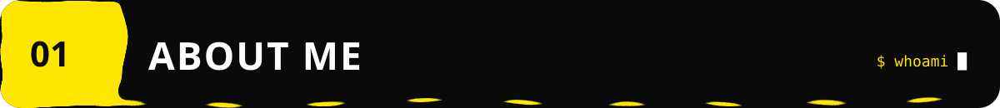


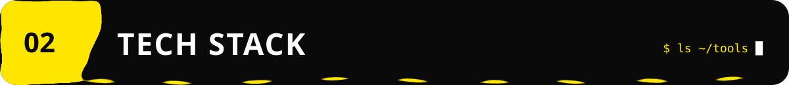


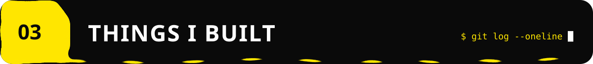

<!-- PROJECTS:START -->
<a href="https://github.com/Dev-2141/scroll-hero-frame">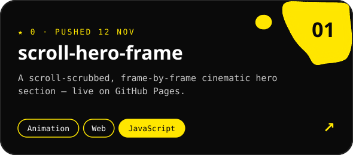</a>
<a href="https://github.com/Dev-2141/portio">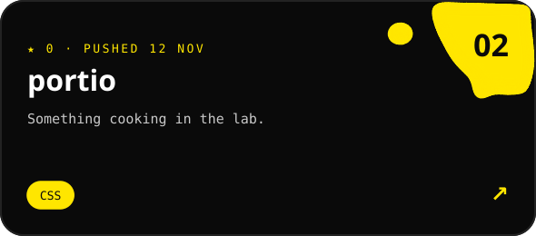</a>
 
<a href="https://github.com/Dev-2141/THE-DAY">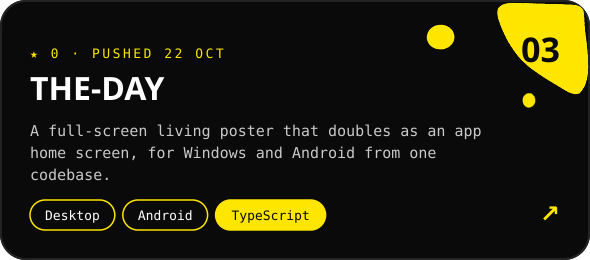</a>
<a href="https://github.com/Dev-2141/Edusphere">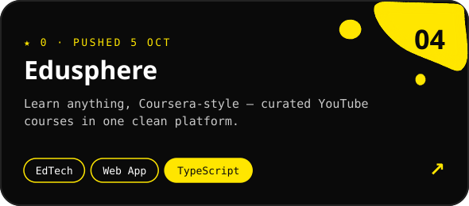</a>
 
<a href="https://github.com/Dev-2141/spectra-raw">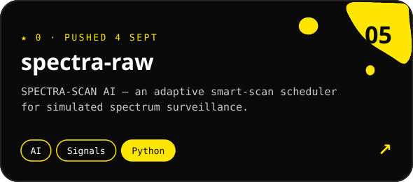</a>
<a href="https://github.com/Dev-2141?tab=repositories">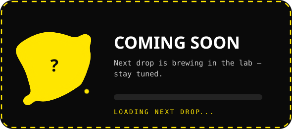</a>
<!-- PROJECTS:END -->

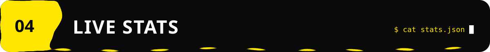


<a href="https://github.com/Dev-2141">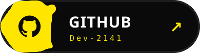</a>
<a href="https://github.com/Dev-2141?tab=repositories">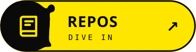</a>
<a href="https://github.com/Dev-2141?tab=followers">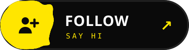</a>

 

